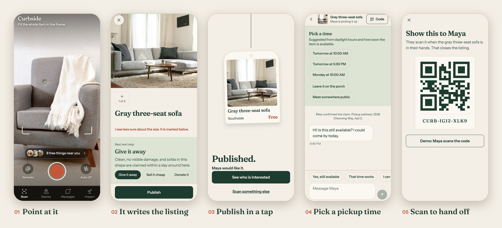
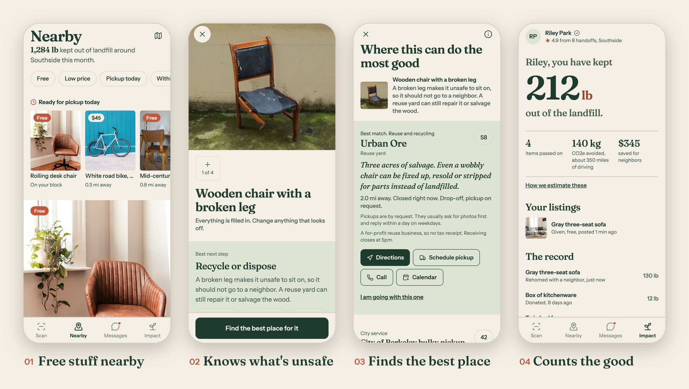

# Curbside

**Point your camera at furniture you no longer need. Curbside writes the listing, finds a neighbor who wants it, and handles the pickup. If it shouldn't go to a neighbor, it finds the place nearby that will do the most good with it.**



## Why

Getting rid of a couch the right way is a chore. You have to take photos, measure it, write a description, answer "is this still available?" ten times, and coordinate a pickup. Most people give up and leave it on the curb, or it goes to landfill. Curbside turns all of that into one photo.

## What it does

- **One photo, whole listing.** A vision model names the item, then fills in its condition, size, weight, how many people it takes to carry, material, tags and a description in a neighbor's voice. It marks anything it's unsure about for a second look, and the "Not a ___?" row fixes a wrong guess in one tap.
- **Honest about what shouldn't be passed on.** Broken, unsafe and regulated items (mattresses, cribs, car seats, refrigerant appliances) can't be listed. Curbside explains why and goes straight to the finder.
- **Ranks where it should go.** The finder scores real Berkeley and Oakland reuse yards, charities and city services by how much good they'd do with this specific item. A paid hauler never outranks a charity.
- **Pickup without the back-and-forth.** Suggested pickup times, porch pickup, a calendar invite, and your address stays hidden until you confirm the person claiming it.
- **QR handoff closes the loop.** One scan marks the item picked up, asks both people for a rating, and adds the pounds kept out of landfill to your impact page.



## Try it

```bash
npm install
npx expo start
```

Scan the QR code with Expo Go, or press `w` to open it in a browser. **No keys or accounts are needed.** Tap **Samples** on the camera screen to run a full scan on a sofa, office chair, bookshelf, microwave, broken chair or mattress. Seeded Berkeley neighbors, listings and a scripted neighbor named Maya fill in the other side, so the whole demo works on one phone with no signal.

The 90-second walkthrough is in [docs/DEMO_SCRIPT.md](docs/DEMO_SCRIPT.md).

### Scan real items (free Gemini key, nothing to deploy)

```bash
cp .env.example .env          # then set GEMINI_API_KEY=... (free from Google AI Studio)
npx expo start                # phone on the same Wi-Fi
npx expo start --tunnel       # campus or guest Wi-Fi, or phone on cellular
```

That's the whole setup. The Expo dev server answers scans itself at `/curbside-scan` (see `metro.config.js`), so the phone scans through the same connection it loads the app from. The key stays in `.env` on the laptop and never ships in the app. Restart `npx expo start` after changing `.env`.

Without a key, the camera doesn't pretend: a real photo shows a "Demo mode" note and offers the samples instead of a made-up result. The Expo terminal logs what the model saw for every scan (`[scan] ... saw: ...`), which is the quickest way to judge accuracy.

**Models.** Gemini by default: `gemini-3.5-flash` with minimal thinking, hedged with `gemini-3.1-flash-lite`. If the first model has not answered in 6 s the second starts too, and the first good answer wins, so a busy Google region costs seconds instead of a failed scan. Claude (`claude-sonnet-5-5`, forced tool call) works the same way with `ANTHROPIC_API_KEY`; if both keys are set, `SCAN_PROVIDER` picks one.

**When it gets it wrong.** The edit screen shows what the model saw and a "Not a ___?" row with its runner-up guesses. Tapping one, or typing what it really is, re-scans the same photo with that as a hint, so size, weight, pickup, safety and the suggested action are redone for the right kind of item.

`npm run scan-server` still exists for pointing the app at a separate machine with `EXPO_PUBLIC_SCAN_URL`.

The demo photos ship inside the app (`assets/seed/`), so the feed and sample scans look right offline.

### Demo controls

- **Samples** on the scanner runs a full scan on a sample photo: sofa, office chair, bookshelf, microwave, broken chair, mattress.
- **Long-press the Curbside wordmark** on the scanner to open a hidden debug panel. It shows whether the last scan was live or a sample, switches you between Riley (you) and Maya (the neighbor), and resets all data.
- In demo mode a scripted neighbor claims what you publish, answers in chat, and stands in for the second phone at the QR handoff.

## Turn on the backend

1. Create a Supabase project. Enable anonymous sign-ins (Authentication > Providers).
2. Apply the schema and seed the donation places:
   ```bash
   supabase link --project-ref <ref>
   supabase db push
   psql "$DATABASE_URL" -f supabase/seed.sql
   ```
3. Deploy the scanner function and give it a key:
   ```bash
   supabase secrets set ANTHROPIC_API_KEY=sk-ant-... ANTHROPIC_MODEL=claude-sonnet-5-5
   supabase functions deploy scan-item
   ```
4. Copy `.env.example` to `.env` and fill in `EXPO_PUBLIC_SUPABASE_URL` and `EXPO_PUBLIC_SUPABASE_ANON_KEY`. Scans now go to the live model. Set `EXPO_PUBLIC_BACKEND=supabase` to sync listings and chat as well.
5. Optional: `SUPABASE_URL=... SUPABASE_SERVICE_ROLE_KEY=... npm run seed` creates the demo neighbors and their listings in the live project.

The backend half has not yet been run against a live project. See [docs/LIMITATIONS.md](docs/LIMITATIONS.md).

## How it fits together

```
phone                                         Supabase
─────                                         ────────
scanner ─ on-device check (blur, light)
        ─ resize to 1024px ──▶ Expo dev server /curbside-scan (metro.config.js),
                               npm run scan-server, or the scan-item edge function
                                 all run _shared/scan-core.ts:
                                 Gemini (or Claude) vision, structured output that
                                 names the object literally before listing it,
                                 zod validation, one retry with the errors
        ◀── validated JSON ──  (or "no item": a retake tip, never a guess)
        └ no AI reachable: says so; samples still run the full flow

zustand store (persisted on device)  ◀──────▶ Postgres + PostGIS, RLS on every table
  listings, claims, chat, handoffs              Realtime on messages and claims
  every action lands locally first,             Storage bucket for listing photos
  then mirrors to Supabase when synced
```

**Scanner.** `src/app/(tabs)/index.tsx`. Capture runs a fast pre-check on a 64px thumbnail (brightness and Laplacian variance for blur, `src/ai/precheck.ts`) before anything is uploaded. Auto mode fires when the accelerometer says the phone has been still for about a second. The scan contract lives in one file, `supabase/functions/_shared/schema.ts`, used by both the edge function and the app. Each field carries a confidence score, and the edit screen marks anything under 0.7 for a second look.

**Safety routing.** The model flags mattresses, car seats, cribs, refrigerant appliances, hazardous materials and prohibited items. A flagged item can't be published to the marketplace and goes to the finder instead, with a plain explanation.

**Good Score.** `src/lib/goodScore.ts`. The type of place sets the base score (100, 80, 60, 40, 20). Smaller adjustments for pickup, open now, tax receipt and distance only reorder places inside a type, so a paid hauler can never outrank a charity. Places that won't take the item are listed separately with the reason. The "How we rank" sheet in the app shows the same rules.

**Privacy.** Listings only store a point blurred to about 300 m, recomputed by a database trigger. The exact address is in `listing_private`, which row-level security opens to the owner and to a claimant the owner has confirmed.

**Impact.** `src/lib/impact.ts`, mirrored in the `complete_handoff` SQL function. Weight is the middle of the item's weight class. CO2e is weight times a category footprint factor, counted at 50% because not every rehomed item replaces a new purchase. Money saved is the typical used price minus what the neighbor paid. The assumptions are shown in the app.

### Layout

```
src/app/            screens (Expo Router)
  (tabs)/           scanner, nearby feed, messages, impact
  review.tsx        edit the AI listing, then publish
  rehome.tsx        donation and disposal finder
  listing/[id]      item detail and claim queue
  chat/[id]         chat, pickup time, porch or public meetup
  handoff/[id]      QR code, scan, rating, tip
src/ai/             scan client, mocks, on-device pre-check
src/data/           store, types, seed data, Supabase sync
src/lib/            Good Score, impact math, formatting, calendar and maps links
src/theme/          design tokens (color, type scale, spacing, motion)
src/components/     shared UI
supabase/           migration, edge function, versioned prompt, seed
```

## Design

Warm paper and forest green with terracotta saved for a few moments: the shutter, prices on free items, the "check this" marks. Fraunces for headings, Instrument Sans for everything else, and Lucide icons at one stroke weight. The feed alternates a full-width photo with an uneven pair. Dark mode keeps the warmth with a brown-black base. All motion checks the reduced-motion setting.

## Scripts

| Command | What it does |
| --- | --- |
| `npm start` | Expo dev server, which also answers live scans when `.env` has a key |
| `npm run scan-server` | Standalone scan server on port 8787 (needs `GEMINI_API_KEY` or `ANTHROPIC_API_KEY` in `.env`) |
| `npm run lint` | Expo lint |
| `npm run typecheck` | Strict TypeScript for the app and scripts |
| `npm run export:web` | Production web build into `dist/` |
| `npm run seed:sql` | Regenerate `supabase/seed.sql` from `src/data/seed/places.ts` |
| `npm run seed` | Same, plus demo users and listings in a live project |

## Built with

Expo SDK 58 and Expo Router, React Native with Reanimated, Zustand, Gemini and Claude vision with zod-validated structured output, and Supabase (Postgres, PostGIS, row-level security, Realtime, edge functions).

## More

- [90-second demo script](docs/DEMO_SCRIPT.md)
- [Known limitations and next steps](docs/LIMITATIONS.md)

The app icon is drawn by `scripts/make_icons.py`. Demo photos are from Unsplash, Wikimedia Commons, Flickr and the WordPress Photo Directory under free licenses. Sources and authors are in [docs/PHOTO_CREDITS.md](docs/PHOTO_CREDITS.md).
